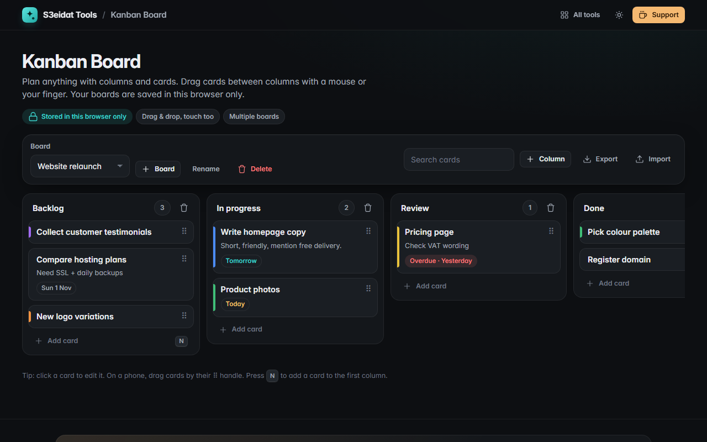

# Kanban Board

> A simple, private Kanban board. Free, private, and it runs entirely in your browser.

### ▶ [Open Kanban Board](https://s3eidat.github.io/kanban-board/)



## Features

- **Multiple boards**: create, rename, switch, delete (with undo)
- **Columns**: add, rename inline, delete (with undo)
- **Cards** with title, notes, **colour label** and **due date** (overdue / today / soon highlighted)
- **Drag and drop** cards within and between columns using pointer events: mouse, pen, and touch (drag by the ⠿ handle on phones)
- Move a card from the keyboard too: open it and pick its column
- Quick add: press <kbd>N</kbd> or "Add card", type, Enter, keep typing
- **Search** across card titles and notes
- **Export / import JSON** (imported files are validated; nothing in them is ever rendered as HTML)

## Privacy

Your boards never leave your device. They are stored in your browser's localStorage, with no server, no account
and no analytics. The page ships with a strict Content-Security-Policy (`connect-src 'self'`), so the browser
itself blocks any attempt to send data anywhere. Clearing your browser data deletes your boards, so export a backup.

## Run it yourself

It's plain HTML, CSS and JavaScript with no build step:

```bash
git clone https://github.com/s3eidat/kanban-board
cd kanban-board
python -m http.server 8000
```

Then open http://localhost:8000.

## Support

If this saved you time, **[buy me a coffee ☕](https://s3eidat.github.io/coffee/)**. It keeps every tool free.

---

Part of **[S3eidat Tools](https://s3eidat.github.io/)**: 100+ free, private tools that run in your browser. MIT licensed.
